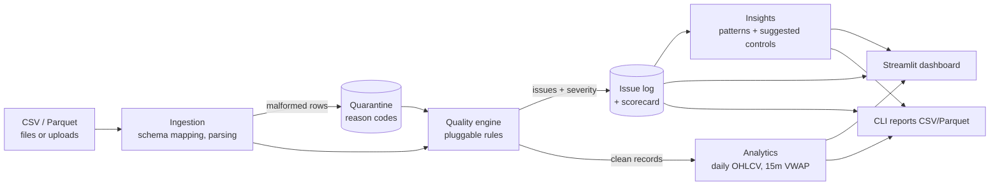

# Architecture Overview

## Layered design



| Layer | Module | Responsibility | Knows nothing about |
|---|---|---|---|
| Schema | `schema.py` | Canonical columns, vendor aliases, exchange timezone | Files, rules, UI |
| Ingestion | `ingestion.py` | Read, map, parse, quarantine malformed rows, lineage | Business rules |
| Quality | `quality.py` | Rules → issues; build clean set; scorecard | File formats, UI |
| Analytics | `analytics.py` | Pure functions on clean data | Where data came from |
| Insights | `insights.py` | Patterns + recommendations from issues | How issues were found |
| Orchestration | `pipeline.py`, `cli.py` | Wire layers together | — |
| Presentation | `app/dashboard.py` | Filters, charts, downloads, caching | Rule logic |

Each layer depends only on the canonical schema, so a new vendor format
changes only `schema.py`/`ingestion.py`, and a new check is a new `Rule` class.

## Extension points

* **New rule:** subclass `Rule` (`rule_id`, `category`, `severity`, `check()`),
  then add it to `DEFAULT_RULES` or pass `rules=[...]`. No other code changes;
  the UI, scorecard and insights pick it up automatically (tested in
  `test_custom_rule_can_be_plugged_in`).
* **New playbook entry:** add the rule id to `insights.PLAYBOOK`.
* **AI-assisted insights:** implement `InsightProvider.generate()`. An LLM
  provider would receive only *aggregated* statistics (rule counts, patterns),
  never raw records, and its output would be shown alongside the deterministic
  rule-based findings, not instead of them.
* **New input format:** add a reader in `read_raw` and aliases in `COLUMN_ALIASES`.
* **Configuration:** all thresholds live in `QualityConfig` (gap minutes,
  outlier z, negative-price switch, learned-session settings) and are exposed
  in the UI sidebar and the CLI.

## Record lifecycle

```
received ─┬─ malformed ───────────────► quarantine (MALFORMED_RECORD, ERROR)
          └─ parsed ─┬─ ERROR issue ──► excluded from analytics, visible in issue log
                     ├─ exact dup ────► dropped (WARNING)
                     └─ otherwise ────► clean  (may carry WARNING flags)
```

Invariant (tested): `received = clean + excluded + quarantined`.

## Path to production (beyond the exercise)

| Concern | Exercise | Production |
|---|---|---|
| Scale | pandas in-memory (1.4M rows ≈ 17s) | Polars/DuckDB or Spark; partition by root/date; incremental runs |
| Scheduling | On demand | Run after each vendor drop (Airflow/Control-M); alert on score drop |
| Storage | Files | Bronze (raw) / Silver (validated) / Gold (bars, VWAP) tables, issue history |
| Calendars | Learned or default Globex session | Exchange holiday & session calendars per product |
| Governance | Config in code/UI | Rule catalogue owned by Market Data Ops, versioned, with change approval |
| Monitoring | Dashboard | DQ trend over time, SLA per vendor, Kafka/stream checks for real time |
